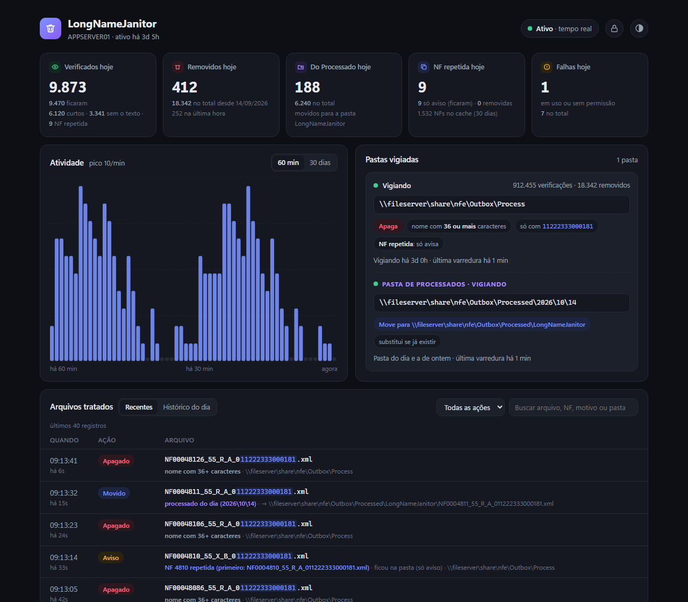

# LongNameJanitor

[](https://github.com/brunosiqp/LongNameJanitor/actions/workflows/build.yml)
[](https://github.com/brunosiqp/LongNameJanitor/releases/latest)


[](LICENSE)

**[English](#english) · [Português](#português)**



---

## English

A lightweight Windows service that keeps integration folders (local or network shares) clean, with a live web
dashboard and admin controls.

### What it does

For each configured folder, only files whose name contains one of the `NameContains` texts (e.g. a company tax ID)
are ever touched:

- **Long names**: a name longer than `MaxNameLength` characters is deleted (or moved).
- **Duplicate document number**: the number is read from the name (`NfPattern`, e.g. `4815322` in
  `NF4815322_55_R_A_0…xml`). The first file kept for a number goes to a per-folder cache; any other file for the same
  number is reported as a **warning** (the file stays) or removed, depending on `DuplicateNf`. Both rules are always
  checked and the reason says which matched (`name with 36+ characters and NF 123 repeated`).
- **Processed folder** (optional): every file with the text that lands in `ProcessedPath\yyyy\MM\dd` (today, and
  yesterday if enabled) is moved to `ProcessedPath\LongNameJanitor`, replacing a file with the same name. The
  **Move everything from Processed** button does the same for all subfolders, in the background, with progress.

How it runs:

- Reacts instantly (`FileSystemWatcher`), plus a full scan on startup and every `RescanMinutes`; oldest files first,
  so the first document of a number is the one kept.
- Network share went away? Reconnects on its own, backing off from 5 s up to 5 min.
- File still being written (locked): retried; otherwise counted as a failure and picked up by the next scan.
- **Dry run (safe mode)**: nothing is deleted or moved; the dashboard and history show what *would* happen.
- **Pause** from the dashboard: no folder is watched until resumed (the state survives restarts).
- Configuration changes (by hand or from the dashboard editor) apply right away, no restart needed.
- Persistent counters (checked, removed, processed, warnings, failures; total and per day), recent activity, the NF
  cache and a daily CSV history in `data\`. CSVs older than `HistoryZipAfterDays` are zipped into
  `data\historico\arquivados`; zips older than `HistoryKeepZipDays` are deleted.
- Idle cost is near zero: ~25 MB of RAM and no polling.

### Dashboard

`http://<server>:5080` shows the state of each folder (and of its processed folder), today's numbers, a chart
(60 minutes / 30 days) and the handled files, with search, a filter by action and the history of any day.

**Admin controls** (lock button at the top): pause/resume, dry run on/off, scan now, move everything from Processed
and the folder editor. They require the admin key: `Dashboard:AdminKey`, or, if empty, the key the service creates in
`data\admin-key.txt` on the server (`install.ps1` prints it). Without the key the dashboard is read-only. Anyone who
can reach the port sees file names; to restrict it, use `"Urls": "http://localhost:5080"` or limit the firewall rule
with `-RemoteAddress`.

### Install on a server

1. Download `LongNameJanitor-win-x64.zip` from the [latest release](https://github.com/brunosiqp/LongNameJanitor/releases/latest)
   (or build it: `dotnet publish -c Release -o publish`). The .exe bundles the runtime: the server needs no .NET.
2. Unzip it on the server and run, in an **elevated PowerShell**:

   ```
   powershell -ExecutionPolicy Bypass -File .\install.ps1
   ```

   - Without an `appsettings.local.json`, the script copies the example to `C:\Tools\LongNameJanitor\`, opens it in
     Notepad and stops. Add your folders, save, and run `install.ps1` again.
   - It asks for the **service account**: a domain account that can modify files in the network folders.
   - It grants "Log on as a service", creates the service (delayed auto start, restarts on failure), opens port
     5080, starts it, checks every folder and prints the admin key.
3. Open the dashboard at `http://<server>:5080`.

**Update:** double-click `ATUALIZAR.bat` in the new package. It finds the installation (service or the running .exe),
backs it up to `backup\<date>`, replaces the .exe and the package's configuration, keeps `data\` (counters, NF cache,
history, admin key), starts it again the same way and prints each folder's state. **Remove:** `uninstall.ps1`. Options: `.\install.ps1 -InstallDir D:\Apps\LongNameJanitor -Port 8080`.

### Configuration

- `appsettings.json`: general settings (dashboard port, admin key, rescan interval, cache and history retention).
- `appsettings.local.json`: **your folders and rules**. Not tracked by git; start from
  [appsettings.local.example.json](appsettings.local.example.json). The dashboard editor writes here too.

| Field | Meaning |
|---|---|
| `Urls` | Dashboard address. `http://*:5080` accepts other machines. |
| `Dashboard:AdminKey` | Admin key. Empty = generated in `data\admin-key.txt`. |
| `Janitor:DryRun` | `true` = dry run in every folder (the dashboard toggles this). |
| `Janitor:RescanMinutes` | Safety rescan interval. |
| `Janitor:NfCacheDays` | Days a document number stays in the cache without being seen (default 30). |
| `Janitor:HistoryZipAfterDays` / `HistoryKeepZipDays` | Zip daily CSVs after N days / delete zips after N days. |
| `Janitor:DataPath` | Where counters, cache and history live (default: `data` next to the .exe). |
| `Path` | Watched folder. In JSON every `\` becomes `\\`. Always use `\\server\...`: services cannot see mapped drives. |
| `NameContains` | **Required.** Texts the name must contain (any one); files without them are never touched. |
| `Action` / `MoveTo` | `Delete`, or `Move` to `MoveTo` (name clashes get a `_yyyyMMdd_HHmmssfff` suffix). |
| `MaxNameLength` / `CountExtension` | Names longer than this are removed; `true` counts the extension. |
| `CleanFolder` / `LongNameRule` | Turn off cleaning this folder / the long-name rule. |
| `DuplicateNf` | `Warn` (report, file stays), `Delete` (remove like a long name) or `Off`. |
| `NfPattern` | Regex whose group 1 is the document number. Default `^NF0*(\d+)_` (leading zeros ignored). |
| `ProcessedPath` | Processed folder with `yyyy\MM\dd` subfolders (optional). |
| `ProcessedAuto` / `ProcessedYesterday` | Move today's processed files automatically / also look at yesterday's folder. |
| `IncludeSubdirectories` / `DryRun` | Also watch subfolders / dry run only in this folder. |

Logs go to Event Viewer > Application, source `LongNameJanitor`. Running the .exe directly works the same way,
logging to the screen; any setting can be overridden on the command line (`--Janitor:DryRun=true`).

---

## Português

Serviço leve do Windows que mantém limpas as pastas de integração (locais ou de rede), com painel no navegador e
controles de administrador.

### O que faz

Em cada pasta configurada, só são mexidos os arquivos cujo nome contém um dos textos de `NameContains` (ex.: o CNPJ):

- **Nome longo**: nome com mais de `MaxNameLength` caracteres é apagado (ou movido).
- **NF repetida**: o número sai do nome (`NfPattern`, ex.: `4815322` em `NF4815322_55_R_A_0…xml`). O primeiro arquivo
  que fica de cada NF entra num cache por pasta; outro arquivo da mesma NF vira **aviso** (o arquivo fica) ou é
  removido, conforme `DuplicateNf`. As duas regras são olhadas sempre e o motivo diz o que bateu
  (`nome com 36+ caracteres e NF 123 repetida`).
- **Pasta de processados** (opcional): todo arquivo com o texto que cai em `ProcessedPath\AAAA\MM\DD` (hoje e, se
  quiser, ontem) é movido para `ProcessedPath\LongNameJanitor`, substituindo o de mesmo nome. O botão **Mover tudo do
  Processado** faz o mesmo em todas as subpastas, em segundo plano, com o andamento no topo.

Como roda:

- Reage na hora (`FileSystemWatcher`) e também varre ao iniciar e a cada `RescanMinutes`, do mais antigo para o mais
  novo (com NF repetida, fica o documento que chegou primeiro).
- Pasta de rede caiu? Reconecta sozinho, com espera crescente de 5 s até 5 min.
- Arquivo em uso: tenta de novo; se não der, conta como falha e a próxima varredura pega.
- **Modo simulação (seguro)**: nada é apagado nem movido; o painel e o histórico mostram o que *seria* feito.
- **Pausar** pelo painel: nenhuma pasta é vigiada até retomar (vale mesmo depois de reiniciar).
- Mudança de configuração (à mão ou pelo editor do painel) vale na hora, sem reiniciar.
- Contadores salvos (verificados, removidos, processados, avisos, falhas; total e por dia), atividade recente, cache
  de NF e histórico em CSV por dia em `data\`. CSV com mais de `HistoryZipAfterDays` dias vira zip em
  `data\historico\arquivados`; zip com mais de `HistoryKeepZipDays` dias é apagado.
- Parado, quase não gasta nada: ~25 MB de memória e nenhuma varredura contínua.

### Painel

`http://<servidor>:5080` mostra o estado de cada pasta (e da de processados), os números de hoje, um gráfico (60 min /
30 dias) e os arquivos tratados, com busca, filtro por ação e o histórico de qualquer dia.

**Controles de administrador** (cadeado no topo): pausar/retomar, ligar/desligar a simulação, varrer agora, mover
tudo do Processado e o editor das pastas. Pedem a chave: `Dashboard:AdminKey` ou, se vazio, a que o serviço cria em
`data\admin-key.txt` no servidor (o `install.ps1` mostra). Sem a chave, o painel só mostra. Quem alcança a porta vê
os nomes dos arquivos; para restringir, use `"Urls": "http://localhost:5080"` ou limite o firewall com `-RemoteAddress`.

### Instalar no servidor

1. Baixe o `LongNameJanitor-win-x64.zip` do [último release](https://github.com/brunosiqp/LongNameJanitor/releases/latest)
   (ou gere: `dotnet publish -c Release -o publish`). O .exe já leva o runtime: o servidor não precisa de .NET.
2. Descompacte no servidor e rode num **PowerShell como administrador**:

   ```
   powershell -ExecutionPolicy Bypass -File .\install.ps1
   ```

   - Sem `appsettings.local.json`, o script copia o exemplo para `C:\Tools\LongNameJanitor\`, abre no Bloco de
     Notas e para. Coloque suas pastas, salve e rode o `install.ps1` de novo.
   - Ele pede a **conta do serviço**: uma conta de domínio com permissão de modificar arquivos nas pastas de rede.
   - Dá o direito "Fazer logon como serviço", cria o serviço (início automático atrasado, reinicia se cair), libera a
     porta 5080, inicia, confere cada pasta e mostra a chave de administrador.
3. Abra o painel: `http://<servidor>:5080`.

**Atualizar:** duplo clique no `ATUALIZAR.bat` do pacote novo. Ele acha a instalação (serviço ou o .exe aberto),
guarda uma cópia em `backup\<data>`, troca o .exe e a configuração do pacote, mantém `data\` (contagem, cache de NF,
histórico, chave de administrador), liga de novo do mesmo jeito e mostra o estado de cada pasta.
**Remover:** `uninstall.ps1`. Opções: `.\install.ps1 -InstallDir D:\Apps\LongNameJanitor -Port 8080`.

### Configuração

- `appsettings.json`: valores gerais (porta do painel, chave de administrador, varredura, validade do cache e do histórico).
- `appsettings.local.json`: **suas pastas e regras**. Fica fora do git; parta do
  [appsettings.local.example.json](appsettings.local.example.json). O editor do painel grava aqui também.

| Campo | O que faz |
|---|---|
| `Urls` | Endereço do painel. `http://*:5080` aceita acesso de outras máquinas. |
| `Dashboard:AdminKey` | Chave de administrador. Vazio = gerada em `data\admin-key.txt`. |
| `Janitor:DryRun` | `true` = simulação em todas as pastas (o botão do painel muda isto). |
| `Janitor:RescanMinutes` | Intervalo da varredura de segurança. |
| `Janitor:NfCacheDays` | Dias que uma NF fica no cache sem aparecer (padrão 30). |
| `Janitor:HistoryZipAfterDays` / `HistoryKeepZipDays` | Zipar o CSV do dia depois de N dias / apagar o zip depois de N dias. |
| `Janitor:DataPath` | Onde ficam contadores, cache e histórico (padrão: `data` ao lado do .exe). |
| `Path` | Pasta vigiada. Em JSON cada `\` vira `\\`. Use sempre `\\servidor\...`: serviços não enxergam unidades mapeadas. |
| `NameContains` | **Obrigatório.** Textos que o nome precisa conter (basta um); arquivo sem eles nunca é mexido. |
| `Action` / `MoveTo` | `Delete`, ou `Move` para `MoveTo` (nome repetido ganha `_aaaaMMdd_HHmmssfff`). |
| `MaxNameLength` / `CountExtension` | Nome maior que isso sai; `true` conta a extensão. |
| `CleanFolder` / `LongNameRule` | Desligar a limpeza da pasta / a regra de nome longo. |
| `DuplicateNf` | `Warn` (avisa, o arquivo fica), `Delete` (remove como nome longo) ou `Off`. |
| `NfPattern` | Regex cujo grupo 1 é o número da NF. Padrão `^NF0*(\d+)_` (zeros à esquerda ignorados). |
| `ProcessedPath` | Pasta de processados, com subpastas `AAAA\MM\DD` (opcional). |
| `ProcessedAuto` / `ProcessedYesterday` | Mover sozinho o processado do dia / olhar também a pasta de ontem. |
| `IncludeSubdirectories` / `DryRun` | Vigiar também as subpastas / simular só nesta pasta. |

Logs: Visualizador de Eventos > Aplicativo, origem `LongNameJanitor`. Rodando o .exe direto ele funciona igual, com o
log na tela; qualquer valor pode ser trocado pela linha de comando (`--Janitor:DryRun=true`).

---

[MIT](LICENSE) © brunosiqp
